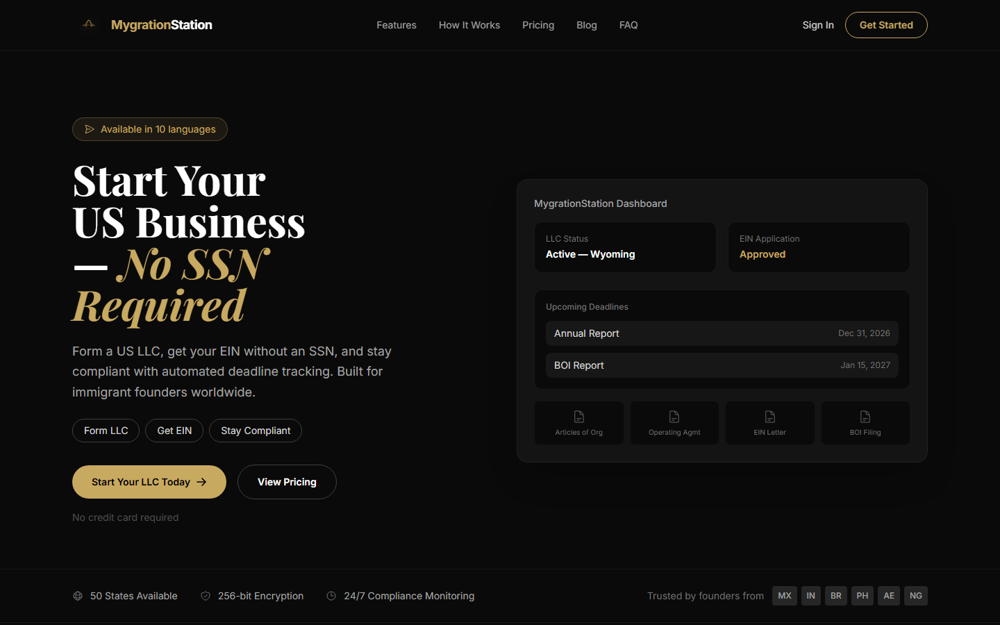
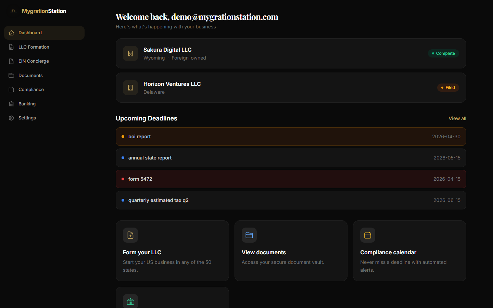
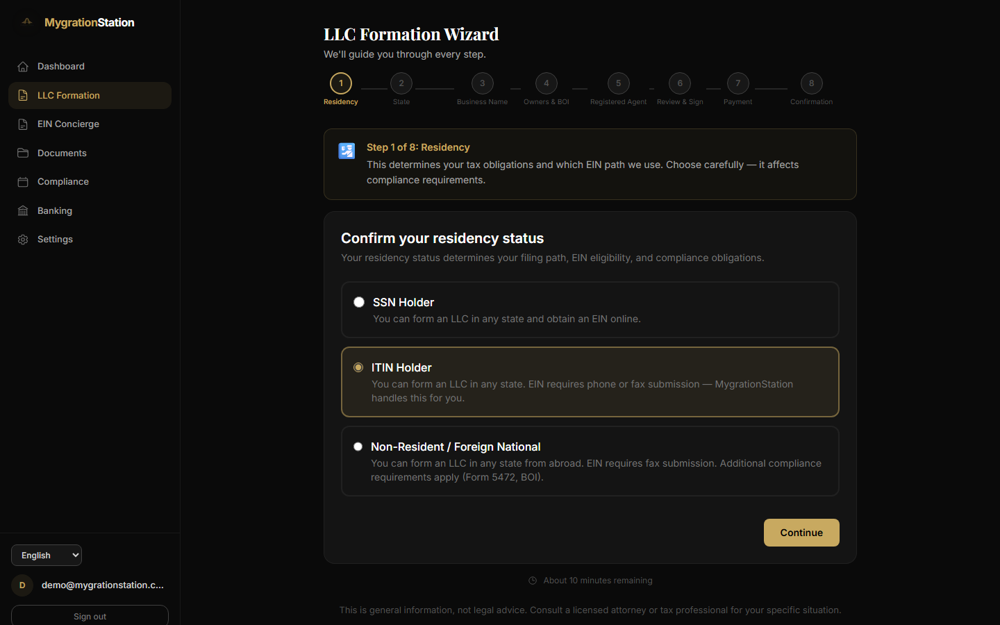
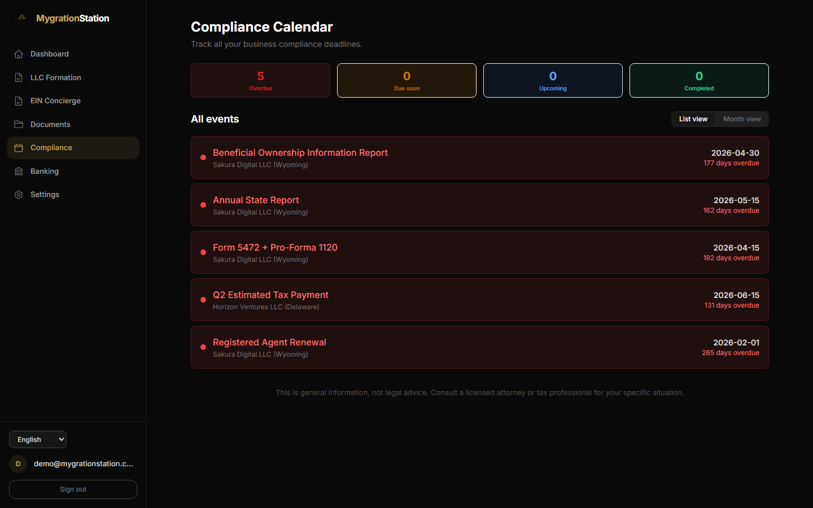
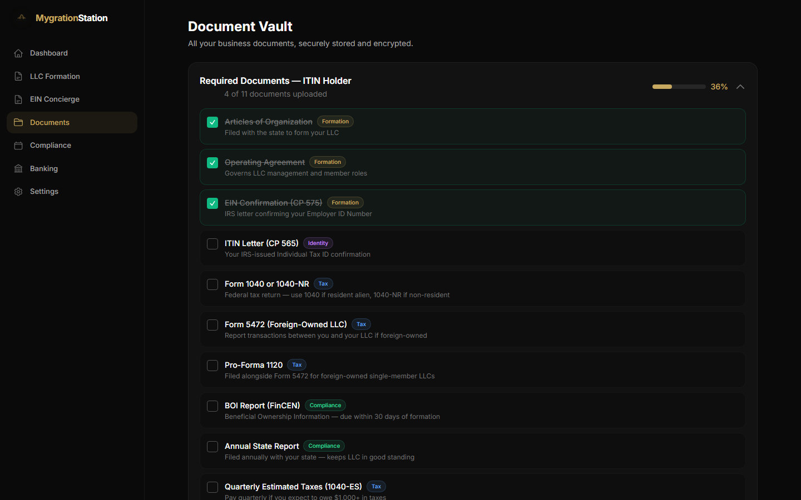
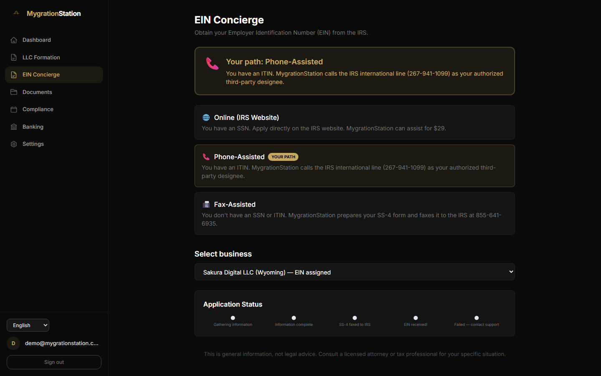

# US business formation for immigrant founders

MygrationStation lets someone outside the US, or inside it without a Social Security Number, form
an LLC, get an EIN, keep a vault of their company documents and stay on top of filing deadlines, in
ten languages. It was built for a client launching the service and runs on Vercel at
[mygrationstation.vercel.app](https://mygrationstation.vercel.app).

I designed and built Phase 1 end to end: the public site and blog, the sign-up and onboarding
flow, the eight-step formation wizard, the EIN concierge, the document vault, the compliance
calendar, the banking profiler, the admin queues, the Stripe checkout and post-payment pipeline,
the PDF generators, the Supabase schema with row-level security, the ten-locale translation
layer and the Vercel deployment.



## What it does

**For founders**
- Pick a residency status (SSN, ITIN or neither) and the product adapts: which EIN route applies,
  which forms are due and which banks will take the application
- An eight-step LLC formation wizard (residency, state, name, owners, registered agent, review,
  payment, confirmation) that saves progress to the database so it can be resumed on any device
- After payment, Articles of Organization and an Operating Agreement are generated as PDFs,
  dropped into the vault and the founder is emailed in their own language
- EIN concierge with three paths: online for SSN holders, phone-assisted for ITIN holders and a
  pre-filled IRS Form SS-4 for fax submission when there is neither
- A document vault with a per-residency checklist, uploads with type and size checks, 15-minute
  signed download links and 24- or 72-hour share links
- A compliance calendar generated at formation: BOI report, Form 5472 and pro-forma 1120 for
  foreign-owned companies, quarterly estimated taxes, annual state report and registered-agent
  renewal, shown as a list or month view with overdue, due-soon and upcoming states
- A five-question banking profiler that ranks six immigrant-friendly banks with pros and cons
- Everything in English, Spanish, Chinese, Tagalog, Vietnamese, Arabic (right-to-left), French,
  Korean, Portuguese or Hindi

**For the operator**
- An admin page with the formation queue and the EIN task queue, limited to configured admin
  emails
- Three one-off tiers (Standard, Pro, Premium) sold through Stripe Checkout, confirmed by webhook

## How it is built

- **Server first:** React Server Components by default and Server Actions for the mutations; the
  wizard's eight steps are client components, but each save goes through a Server Action and the
  draft lives in a JSONB column so it can be resumed
- **Data:** nine Supabase tables, each with row-level security; the admin uses the service-role key
  on the server only
- **Sensitive fields:** EINs and ITINs are encrypted with AES-256-GCM in the application before
  they reach Postgres
- **Routing and access:** one middleware handles locale detection (URL prefix, cookie,
  Accept-Language) and guards every dashboard route through Supabase Auth
- **Demo mode:** a `DEMO_MODE` switch swaps the Supabase client for an in-memory one with sample
  businesses, deadlines and documents, so the whole dashboard renders without a database
- **Integrations:** Stripe Checkout and webhooks, Resend for four transactional emails, pdf-lib for
  the state documents and SS-4, and a DocuSeal e-signature flow with its webhook handler ready

## Stack

| Layer | Choice |
|---|---|
| Framework | Next.js 14 App Router, React 18, TypeScript strict |
| UI | Tailwind CSS 3 with the RTL plugin, lucide icons, Inter and Playfair Display |
| i18n | next-intl with ten locale files of matching coverage |
| Data and auth | Supabase (Postgres, Auth, private Storage), SQL migrations in `supabase/` |
| Payments | Stripe Checkout, webhooks, three price tiers |
| Documents | pdf-lib generators, DocuSeal integration |
| Email | Resend with React Email components |
| Validation | Zod schemas |
| Hosting | Vercel |

## Engineering

- **Type-safe end to end:** TypeScript in strict mode, Zod schemas for the forms and actions, and
  Supabase types generated from the schema (`npm run supabase:gen-types`)
- **Checks before deploy:** `npm run typecheck` and `npm run lint` are the gate; there is no test
  suite yet
- **Reviewable without infrastructure:** demo mode lets anyone walk the whole dashboard with
  sample data and no Supabase project

## Screenshots

| | |
|---|---|
|  |  |
| Dashboard: businesses and upcoming deadlines | LLC formation wizard, step 1 of 8 |
|  |  |
| Compliance calendar | Document vault with the ITIN-holder checklist |
|  | |
| EIN concierge: the path chosen from residency | |

The landing page was captured from the app running locally; the dashboard pages were captured in
the built-in demo mode with its sample data.

## Running it locally

```
cd MygrationStation
npm install
cp .env.local.example .env.local     # Supabase, Stripe, Resend, DocuSeal, ENCRYPTION_KEY
npx supabase db push                 # or run supabase/migrations/*.sql in the SQL editor
npm run dev                          # http://localhost:3000
DEMO_MODE=true npm run dev           # dashboard with sample data, no database needed
npm run typecheck && npm run lint
```

Generate `ENCRYPTION_KEY` with
`node -e "console.log(require('crypto').randomBytes(32).toString('hex'))"`.
The real `.env.local` was deliberately excluded from this repository.

## Repository notes

- `MygrationStation/` is the canonical Next.js project. `MygrationStation.zip` is an earlier
  snapshot and `MygrationStation-Phase1-Delivery.zip` is the archive handed over with
  `DELIVERY.md` on 16 April 2026.
- `MygrationStation/.git-history/` is the original nested git metadata preserved as plain files;
  the project started life under the name H1Boss and was rebranded in Phase 1.
- `.vercel/project.json` links the folder to the `mygrationstation` Vercel project.
